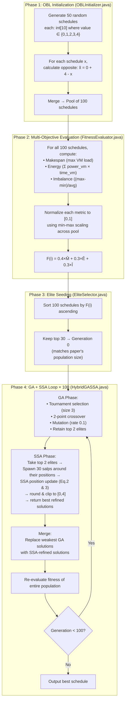

# 🏗️ Implementation Plan: OBL-Enhanced HGA-SSA Cloud Task Scheduler

## 1. Project Overview

We are implementing an **improved version** of the Hybrid GA-SSA (HGA-SSA) cloud task scheduler from the paper *"Hybrid Metaheuristic-Based Cloud Task Scheduling Using Genetic Algorithm and Salp Swarm Algorithm"* (ICTCS 2025).

### What the Paper Does (Baseline)
- Schedules **10 tasks** (random durations 10–100s) across **5 VMs** (processing power 0.8–1.2)
- Uses GA (population 30, tournament size 3, 2-point crossover, 0.1 mutation) + SSA (30 salps)
- **Random initialization** of population
- **Single objective**: Minimize makespan only
- Achieves **115.60s** makespan

### Our Two Mathematical Optimizations
| Optimization | Replaces | Description |
|---|---|---|
| **Opposition-Based Learning (OBL)** | Random-only initialization | Generates 50 random + 50 opposite candidates → picks best 50 |
| **Multi-Objective Fitness** | Single-objective (makespan) | `F(i) = α·Makespan + β·Energy + γ·Imbalance` (normalized, weighted) |

### Expected Outcome
Our OBL + multi-objective model should achieve a **lower makespan than 115.60s** and additionally optimize for energy and load balance — metrics the original paper ignores entirely.

---

## 2. Technology Stack

| Layer | Technology | Purpose |
|---|---|---|
| **Cloud Simulation** | [CloudSim 3.0.3](https://github.com/Cloudslab/cloudsim) (Java) | Simulate Datacenter, Hosts, VMs, Cloudlets |
| **Scheduling Algorithm** | Java (integrated into CloudSim) | OBL, GA, SSA, multi-objective fitness — all inside a custom `DatacenterBroker` |
| **Visualization & Analysis** | Python (NumPy, Pandas, Matplotlib) | Convergence plots, result tables, baseline comparison |
| **Build System** | Maven | Dependency management for CloudSim |
| **Version Control** | Git + GitHub | PRs, code review, branch-per-member workflow |

> [!IMPORTANT]
> The **algorithm logic lives in Java** within CloudSim (not Python). Python is used **only** for post-processing — reading the CSV output from CloudSim and generating plots/tables. This is the standard academic approach for CloudSim-based research.

---

## 3. Project Directory Structure

```
OBL-based-improvement-in-cloud-scheduling/
├── README.md
├── pom.xml                                    # Maven config (CloudSim dependency)
│
├── src/main/java/org/cloudscheduler/
│   │
│   ├── config/
│   │   └── SimulationConfig.java              # All constants (NUM_TASKS, NUM_VMS, weights, seed, etc.)
│   │
│   ├── simulation/
│   │   ├── CloudEnvironment.java              # Datacenter, Host, VM, Cloudlet creation
│   │   └── MainSimulation.java                # Entry point — wires everything, runs simulation
│   │
│   ├── algorithm/
│   │   ├── OBLInitializer.java                # Step A: OBL pool generation (50 random + 50 opposite)
│   │   ├── FitnessEvaluator.java              # Step B: Multi-objective fitness (normalize + weight)
│   │   ├── EliteSelector.java                 # Step C: Sort & keep top 50
│   │   ├── GeneticAlgorithm.java              # GA operators (tournament, crossover, mutation)
│   │   ├── SalpSwarmAlgorithm.java            # SSA position update (leader + follower, discretized)
│   │   └── HybridGASSA.java                   # Step D: Main GA+SSA loop (100 generations)
│   │
│   ├── model/
│   │   ├── Schedule.java                      # A single candidate schedule (int[] taskToVM mapping)
│   │   └── VMInfo.java                        # VM metadata (id, processing power, assigned load)
│   │
│   ├── metrics/
│   │   └── MetricsCalculator.java             # Makespan, Energy, Imbalance computation
│   │
│   ├── broker/
│   │   └── OBLHGASSABroker.java               # Custom DatacenterBroker that uses HybridGASSA
│   │
│   └── output/
│       └── ResultExporter.java                # Export results to CSV for Python visualization
│
├── analysis/
│   ├── requirements.txt                       # numpy, pandas, matplotlib
│   ├── plot_convergence.py                    # Reads convergence CSV → matplotlib curve
│   ├── generate_tables.py                     # Reads results CSV → formatted comparison table
│   └── compare_baseline.py                    # Compare our makespan vs 115.60s baseline
│
├── results/                                   # Generated at runtime (gitignored, but sample committed)
│   ├── convergence.csv                        # generation, best_fitness, best_makespan, energy, imbalance
│   ├── best_schedule.csv                      # task_id, vm_id, duration, vm_total_time
│   └── summary.txt                            # Final metrics printout
│
└── docs/
    └── IMPLEMENTATION_PLAN.md                 # This file
```

---

## 4. Detailed Algorithm Flow (What Gets Coded)



### Key Formulas Reference

| Metric | Formula | Implementation |
|---|---|---|
| **Execution time per VM** | `time_vm = Σ(task_duration) / processing_power_vm` | `MetricsCalculator.java` |
| **Makespan** | `max(time_vm for all VMs)` | `MetricsCalculator.java` |
| **Energy** | `Σ(processing_power_vm × total_task_time_on_vm)` for all VMs | `MetricsCalculator.java` |
| **Imbalance** | `(max_load - min_load) / avg_load` | `MetricsCalculator.java` |
| **Normalization** | `x_norm = (x - x_min) / (x_max - x_min)` | `FitnessEvaluator.java` |
| **Fitness** | `F(i) = 0.4 × M_norm + 0.3 × E_norm + 0.3 × I_norm` | `FitnessEvaluator.java` |
| **OBL** | `x̃[j] = 0 + 4 - x[j]` for each task j | `OBLInitializer.java` |
| **SSA Leader** | `x = F + c1 × ((ub-lb)×r + lb)` if r₂ ≥ 0.5, else `x = F - c1×((ub-lb)×r + lb)` | `SalpSwarmAlgorithm.java` |
| **SSA Follower** | `x = (x_current + x_prev) / 2` | `SalpSwarmAlgorithm.java` |
| **SSA c1** | `c1 = 2 × e^(-(4t/T)²)` where t=iteration, T=max_iterations | `SalpSwarmAlgorithm.java` |

---

## 5. Configuration Constants (SimulationConfig.java)

All team members must reference these shared constants:

```java
// === Problem Parameters ===
public static final int    NUM_TASKS           = 10;
public static final int    NUM_VMS             = 5;
public static final int    MIN_TASK_DURATION    = 10;    // seconds
public static final int    MAX_TASK_DURATION    = 100;   // seconds
public static final double MIN_VM_POWER         = 0.8;
public static final double MAX_VM_POWER         = 1.2;
public static final int    BASE_MIPS            = 1000;  // MIPS = BASE_MIPS × processing_power

// === OBL Parameters ===
public static final int    OBL_RANDOM_COUNT     = 50;    // generates 50 random + 50 opposite = 100 total
public static final int    OBL_ELITE_COUNT      = 30;    // top 30 from 100 → Generation 0 (matches paper)
public static final int    MIN_VM_INDEX         = 0;
public static final int    MAX_VM_INDEX         = NUM_VMS - 1;  // 4

// === Fitness Weights ===
public static final double ALPHA                = 0.4;   // Makespan weight
public static final double BETA                 = 0.3;   // Energy weight
public static final double GAMMA                = 0.3;   // Imbalance weight

// === GA Parameters ===
public static final int    POPULATION_SIZE      = 30;    // matches paper's population of 30
public static final int    TOURNAMENT_SIZE      = 3;
public static final double MUTATION_RATE        = 0.1;
public static final int    NUM_ELITES           = 2;     // retained per generation, passed to SSA
public static final int    NUM_CROSSOVER_POINTS = 2;

// === SSA Parameters ===
public static final int    NUM_SALPS            = 30;    // full 30-salp swarm spawned around elites

// === Hybrid Loop ===
public static final int    NUM_GENERATIONS      = 100;

// === Reproducibility ===
public static final long   RANDOM_SEED          = 42;
```

---

## 6. Interface Contracts

These are the **exact method signatures** each component must expose so that other components can call them:

### Data Classes

```java
// Schedule.java
public class Schedule {
    int[] taskToVM;          // length = NUM_TASKS, values ∈ [0, NUM_VMS-1]
    double fitness;          // set by FitnessEvaluator
    double makespan;         // raw makespan value
    double energy;           // raw energy value
    double imbalance;        // raw imbalance value
    Schedule copy();         // deep copy
}

// VMInfo.java
public class VMInfo {
    int id;
    double processingPower;  // 0.8 to 1.2
}
```

### Algorithm Components

```java
// OBLInitializer.java
Schedule[] generateOBLPool(VMInfo[] vms, int[] taskDurations, Random rng);
// Returns: 100 Schedule objects (50 random + 50 opposite)

// FitnessEvaluator.java
void evaluateAll(Schedule[] pool, VMInfo[] vms, int[] taskDurations);
// Side effect: sets .fitness, .makespan, .energy, .imbalance on each Schedule

// EliteSelector.java
Schedule[] selectElite(Schedule[] pool, int topN);
// Returns: top N schedules sorted by fitness ascending (topN=30 for init, topN=2 for GA elites)

// GeneticAlgorithm.java
Schedule[] evolve(Schedule[] population, VMInfo[] vms, int[] taskDurations, Random rng);
// Returns: new generation of 30 after selection + crossover + mutation (top 2 elites preserved)

// SalpSwarmAlgorithm.java
Schedule[] refine(Schedule[] elites, int currentGen, int maxGen, VMInfo[] vms, int[] taskDurations, Random rng);
// Takes: top 2 elites from GA
// Internally: spawns 30 salps around elite positions, runs SSA position updates (leader + followers)
// Returns: best 2 SSA-refined schedules (discretized to valid VM indices [0,4])
```

### Orchestration (HybridGASSA.java)

```java
// Pseudocode for the main loop
Schedule[] pool = oblInit.generateOBLPool(vms, taskDurations, rng);  // 100
fitnessEval.evaluateAll(pool, vms, taskDurations);                    // score all 100
Schedule[] population = eliteSelector.selectElite(pool, 30);          // top 30 = Gen 0

for (int gen = 0; gen < NUM_GENERATIONS; gen++) {
    population = ga.evolve(population, vms, taskDurations, rng);      // GA phase (pop=30)
    Schedule[] elites = eliteSelector.selectElite(population, NUM_ELITES); // top 2
    Schedule[] refined = ssa.refine(elites, gen, NUM_GENERATIONS, ...);    // SSA: 30 salps swarm
    replaceWeakest(population, refined);                               // merge refined into pop
    fitnessEval.evaluateAll(population, vms, taskDurations);           // re-evaluate all 30
    logConvergence(gen, getBest(population));                           // track for plotting
}
return getBest(population);
```

---

## 7. Testing Strategy

| What | How | Component |
|---|---|---|
| OBL produces valid opposites | Assert `x + x̃ = 4` for all task indices | `OBLInitializer` |
| GA preserves valid VM range | Assert all values in `[0, 4]` after crossover & mutation | `GeneticAlgorithm` |
| SSA discretization works | Assert output is integer and within `[0, 4]` | `SalpSwarmAlgorithm` |
| Fitness normalization | Assert normalized values are in `[0.0, 1.0]` | `FitnessEvaluator` |
| CloudSim runs without crash | Run `MainSimulation` with round-robin broker | `CloudEnvironment` |
| End-to-end integration | Run full pipeline, verify CSV output is non-empty | `HybridGASSA` |
| Reproducibility | Run twice with seed 42, assert identical results | `MainSimulation` |


